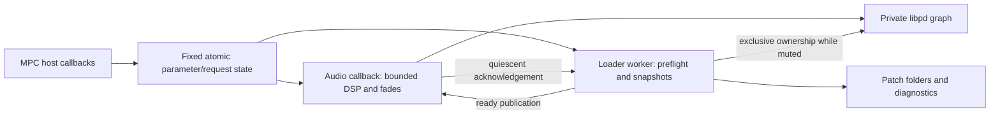

# MPC-PD-LAB Universal Loader v0.1 — proposed technical design

Date: 2026-10-13. **Design awaiting approval; no production implementation.**
Target: original MPC One, ARMv7 hard-float, Hakai 3.9.1, stereo VST2 effect at 44.1 kHz.
Working Delay and Granular Freezer remain separate and unchanged. Their hardware results
are user-reported; new Loader behavior is not hardware-validated.

## 1. Decision and exact prototype scope

Extend the existing private libpd/VST2 bridge with a bounded parameter adapter and a
single worker that owns graph changes after an explicit audio handoff. Reuse the
community ABI/audio adapter, module-relative resource discovery, native Q-Link metadata,
packager and installer. The existing wrapper requires a narrow Loader-only fork because
it currently serializes engine calls with a mutex on the audio path.

The prototype loads **two trusted compatible folder patches at runtime**, selectable by
Q-Links, without recompiling the VST. It supports **one active Universal instance per
loaded module**, alongside the separate existing Delay and Freezer binaries. Switching
requires stopped transport, intentionally fades to silence and resets patch DSP history;
seamless live crossfade is not promised. GUI, CV/Gate, arbitrary externals, Organelle
custom mothers/scripts, MIDI output/Learn and sample streaming are later milestones.

The first two bundled candidates are new small Vanilla test effects, not rewrites of
working plugins: **Stereo Trim** (gain/wet-dry) and **Stereo Low-pass** (fixed 1.2 kHz
low-pass with gain/wet-dry). Both expose the same two control meanings. The low-pass
frequency is deliberately fixed; there is no mapping migration problem in v0.1.
Existing patch folders can be used if they meet the same entry/control contract.

## 2. Identity and preservation boundaries

| Item | Proposed value / policy |
|---|---|
| Plugin name | MPC PD Universal Loader |
| Vendor / folder | CARBALLO / `CARBALLO - VST - MPC PD Universal Loader` |
| Binary | `mpc_pd_universal_loader.so` |
| VST UID | Proposed `MPUL`, hex `4d50554c`; keep stable after first release |
| Role | Audio effect, two inputs/two outputs; not instrument |
| Package/catalog ID | `mpc-pd-universal-loader` |
| Starting runtime pins | Existing libpd `ba0dc63262901d658af8bbda5e619a60fa975e78`, Pd `f009fd8d7b537e209e09898d487fdf1bf547da2b`, wrapper `208745830fc2ed90b2fd0dc480ef5c554284292f` |
| Packaging/tools | Existing Phase 3 reference `5e3a96885b6de76a48b498821c379568a05cc006` |
| Protected identities | `MPDL` / `mpc_pd_delay.so`; `CGFZ` / `organelle_granular_freezer.so` |

No MPUL occurrence was found in the inspected local catalog/own manifests, but this is
not a global uniqueness guarantee. Future package tests must cross-check all known
metadata and installation preflight must refuse an existing UID, binary or folder.
No runtime dependency pins or legacy plugin build paths change as a side effect.
Phase 4 does not need to merge: selectively reuse the audited mapping/diagnostic ideas
with preserved provenance on the implementation branch after approval.

## 3. Runtime files and patch contract

```text
CARBALLO - VST - MPC PD Universal Loader/
  mpc_pd_universal_loader.so
  mpc-plugin.json, plugin-meta.xml, version.xml
  Plugin Skins/                 # native Q-Link bindings; empty/minimal TUI, no custom GUI
  licenses/                     # Pd, libpd, wrapper, parser, example notices
  data/
    defaults/catalog.json       # packaged initial two-slot catalog
    user/                       # declared preserved user-data directory
      catalog.json              # created from defaults only when absent
      patches/trim/manifest.json, main.pd
      patches/lowpass/manifest.json, main.pd
      .loader-cache/            # private per-instance immutable snapshots; not browsed
      loader.log                # bounded worker-written diagnostics
```

The module path helper supplies `data` next to the loaded .so. No `/sdcard`-only path,
process-wide working-directory change, shell script execution or Pd GUI is required.
`user/catalog.json` maps exactly two slots to relative patch folders; IDs are stable
and resolve project recall even if display ordering changes. Refresh the catalog on
plugin creation/reopen in v0.1. Changing the two folders or their Pd text requires no
VST rebuild; editing an active folder is unsupported—stop, unload/reopen and preflight.

A folder contains a `manifest.json`, `main.pd` and optionally audited local `.pd`
abstractions. `main.pd` must be an abstraction with two signal inlets/two signal outlets.
The loader writes a small host canvas in its snapshot connecting `adc~ 1 2` → `main`
→ `dac~ 1 2`, adapting the proven Phase 2 host-canvas pattern. It does not rewrite the
candidate's DSP. `main.pd` cannot be an empty Organelle placeholder or custom mother.

Proposed manifest shape (design example, not an implemented upstream schema):

```json
{
  "schema": 1,
  "id": "stereo-trim",
  "revision": "1",
  "entry": "main.pd",
  "sample_rate": 44100,
  "inputs": 2,
  "outputs": 2,
  "required_files": ["main.pd"],
  "externals": [],
  "controls": [
    {"slot": 0, "key": "gain", "receiver": "ul-gain", "min": 0, "max": 1, "default": 1},
    {"slot": 1, "key": "mix", "receiver": "ul-mix", "min": 0, "max": 1, "default": 1}
  ]
}
```

Both patches implement the same normalized Gain (linear amplitude 0–1) and Mix (dry to
wet 0–1) and smooth control changes over 10 ms using Vanilla signal ramps. No boost or
custom parameter scaling in v0.1. Switching carries current Gain/Mix to the next patch;
there is no hidden per-patch control bank. Revision is an explicit author version, not
a cryptographic guarantee. Project state stores it and refuses an incompatible revision.

Proposed hard limits: 16 KiB manifest, 512 JSON tokens, 64 required Pd files, 128 KiB
per Pd file, 1 MiB total Pd text, 512-byte relative paths, 63-byte IDs/receivers and
31-byte revision strings; exactly two controls. Reject duplicate keys/IDs/slots,
unsupported schema/rate/channel counts, nonfinite/out-of-range values, absolute paths,
`..`, symlinks, binary/script assets and declared externals. ASCII identifier/path subset
for this prototype avoids ambiguous escapes; document that restriction to patch authors.

Reuse the audited MIT **jsmn** tokenizer (`25647e692c7906b96ffd2b05ca54c097948e879c`),
not a new JSON parser. It has no runtime library dependency and uses caller-supplied
tokens. `JSMN_STRICT` is not complete schema/number validation: our manifest layer must
validate the exact grammar, token coverage, types, duplicate keys, ranges and limits.
It runs on the worker. Four upstream native parser configurations each passed 16
checks (64 checks total); these do not validate our proposed schema. No parser source
was integrated in this design phase.

Adapt the Phase 4 offline object audit to a small, explicit Vanilla allowlist and local
abstraction closure. Reject dynamic graph edits, network/file I/O objects, unbounded
control loops, scripts and unsupported objects. Run that audit after every patch edit.
The runtime also verifies manifest/files and captures Pd creation errors. This is a
**trusted curated-patch contract**, not a sandbox or a proof that arbitrary Pd text
cannot hang/crash. First hardware validation uses only the two reviewed examples.

## 4. Architecture and execution ownership



Only one thread may call **any** libpd function at a time, including messages, binding,
search paths and DSP. Keep `MULTI=false`/private hidden Pd. The symbol investigation
shows that dynamic ARM externals would require a separate API-binding design; **none
is needed for Vanilla folder loading**. See [PD_SYMBOL_BOUNDARY.md](PD_SYMBOL_BOUNDARY.md).

| Context | Allowed work | Prohibited work |
|---|---|---|
| Audio | Fixed-buffer conversion, latest Gain/Mix delivery to pre-interned receivers, two Pd ticks, bounded diagnostic capture, fade/zero, 32-bit atomics | File access, graph open/close, allocation/free, JSON, logging, thread join, blocking mutex, waiting for worker |
| Host parameter/restore callbacks | Validate scalar input; bounded atomic publication or fixed-size restore-slot claim; cached readback | Calling Pd, scanning files, loading graph, taking audio's mutex |
| Loader worker | Catalog/manifest/files, immutable snapshots, Pd lifecycle only after ownership handoff, warmup, rollback, diagnostics | Calling host UI APIs or Pd while audio owns the graph |
| Create/close lifecycle | Allocate fixed state/start worker; later close entry gate, wait/join and free when host has stopped callbacks | Freeing an object while host/worker still uses it; assuming effClose can race safely with invalid host use |

Use aligned lock-free 32-bit atomics, verified for the ARMv7 build; no atomic 64-bit or
floating-point assumption. Float controls publish their bit pattern. The worker polls
requests at a small non-real-time interval (proposed 2 ms); audio never signals through
a condition variable/mutex. All retry loops in host/audio callbacks have fixed limits.
A four-slot preallocated restore mailbox uses exclusive slot claims and release/acquire
publication; a full mailbox returns failure rather than blocking. Ordinary control
changes are latest-value mailboxes, since Gain/Mix are levels, not trigger streams.

The wrapper's ordinary `eng_set/get/process/midi` lock is unsuitable for this model.
Create a Loader-only adapter derived from the **pinned** community wrapper, preserving
ABI, conversion, metadata and resource lookup. Its setters/getters use only bounded
cached state; only audio invokes active-engine DSP/messages. Disable unused engine
feedback/MIDI/tempo polling branches and remove their audio locks from the Loader build.
Capture host transport validity explicitly; the current wrapper otherwise ignores
sample-rate/block-size/mains lifecycle notifications. Do not alter either working
plugin's compiled wrapper. A staged/forked wrapper diff must be small and reviewed. Audit every remaining mutable
`wrap_t` field (readback, selector, last-position caches and chunks): make it audio-owned
or use bounded publication. Simply deleting locks while retaining unsynchronized fields
is not an acceptable implementation.

## 5. Switching transaction

| State | Owner / action | Exit condition |
|---|---|---|
| INITIALIZING | Worker owns Pd; audio emits zeros; first load or queued project restore | Valid graph warmed/published, then fade in; failure remains silent with error |
| RUNNING | Audio exclusively renders current graph | User chooses another slot and presses Apply |
| PREFLIGHT | Worker validates/copies candidate closure while old graph keeps rendering | Candidate snapshot valid and transport positively stopped |
| WAIT_STOP / WAIT_CALLBACK | Keep old graph; no ownership change | Stopped time info plus audio callback boundary, or safely deactivated host |
| FADING_OUT | Audio multiplies output by a 512-sample ramp to zero | Final zero block boundary publishes worker ownership |
| LOADING | Audio returns zeros without touching Pd; worker closes old graph, sets paths, opens candidate host, defaults/controls/DSP and warmup | Candidate ready or failure |
| READY_WAIT_STOP | Worker has prepared graph; audio remains silent if transport resumed or is unknown | Stopped callback accepts the matching generation |
| FADING_IN | Audio takes published graph at stopped block boundary; ramp from zero over 512 samples | RUNNING |
| ROLLBACK | Worker closes failed candidate and reconstructs previous immutable snapshot/control state | Previous graph ready → fade in; failure → FAILED_SILENT |
| FAILED_SILENT | No active render; cached error/status retained | User requests a valid candidate; no automatic repeated retry |
| CLOSING | Gate new processing/Pd entry, drain in-flight render, join worker off audio | Graph closed and state freed |

512 frames at 44.1 kHz is 11.61 ms; two fades intentionally add about 23.22 ms around an
unbounded-by-design disk/graph gap. This is **muted switching**, not uninterrupted sound.
No graph tail/filter history survives a switch/rollback. Audio should never miss its
callback deadline because the worker is slow; it can remain silent while loading.

Detailed rules:

1. Changing Patch only changes selection. Apply is an explicit rising-edge action;
   it never runs I/O/Pd inside setParameter. Ignore/reject another Apply while busy,
   with a BUSY status; do not create an unbounded request queue.
2. If transport is playing, retain the request as WAIT_STOP; never switch automatically
   mid-play. User can cancel by selecting the active slot and pressing Apply. Unknown
   transport is not stopped. Initial plugin creation is already silent and is allowed
   to initialize; a later restore/switch follows the same ownership gate.
3. Worker snapshots all required regular files into its own cache before muting. Keep
   the last working snapshot until the next activation commits. No `chdir`, shared
   `/tmp/patch` or shell. Detect size/metadata changes during copy and fail preflight;
   users must not edit folders concurrently. This does not defend against hostile users.
4. At fade completion, audio release-publishes WORKER ownership and performs no Pd calls
   until a matching READY generation is acquire-observed. Worker must see that exact
   generation before any close/open. All parameter callbacks keep updating atomics.
5. Worker captures bounded Pd errors; null graph, unknown objects, diagnostics overflow,
   missing bindings or failed warmup abort activation. Warmup uses preallocated silent
   buffers and interns all receivers before publication. No sample playback/externals.
6. Recheck transport at the final fade-out boundary. If playback resumes before
   quiescence, retain the old graph and ramp back up; keep the request pending. If it
   resumes after quiescence, finish preparation but stay silent in READY_WAIT_STOP until
   a positively stopped callback accepts the graph. Never activate an uncommitted graph
   mid-play or while transport is unknown. New graph receives latest common controls at
   that accepted audio boundary. READY is an
   immutable descriptor until audio acknowledges it. Generation IDs reject stale work;
   an older completion must never overwrite a newer restore/close decision.
7. If callbacks cease while host is stopped, wait without closing the live graph.
   On `effMainsChanged(0)`, close the Pd-entry gate and let the worker wait for the
   in-flight callback count to reach zero before taking ownership. Reactivation during
   worker ownership renders silence. No guessed timer or trylock substitutes for this.
8. A 2-second status timeout is diagnostic only. Never cancel/free a thread inside Pd
   or reclaim a graph it may still use. If trusted patch loading hangs, remain silent;
   application recovery may be required. Native crashes remain capable of crashing MPC.

## 6. Audio contract and Q-Links

Retain stereo interleaved int16 engine processing, 64-frame Pd ticks and the existing
128-frame VST effect path. Require 44.1 kHz/128 frames; unsupported host rate or block
configuration produces initialized zeros and CONFIG_UNSUPPORTED, not stale audio.
Sanitize nonfinite input before float→int16 conversion; saturate at the conversion
boundary. Both example patches are bounded and use no internal unbounded feedback.
Measure actual latency; require the same reported/measured latency for both candidates.
Do not assume an Organelle bus's existing 64-sample delay applies to these direct graphs.

| VST index | Fixed host name | Mapping | Automation/state policy |
|---|---|---|---|
| 0 | Patch | Two-slot enum; normalized 0=A, 1=B, threshold 0.5 | Selection only; not advertised as automatable; active identity saved |
| 1 | Apply | Momentary rising edge; repeated high is idempotent, low rearms | Not automatable, never persisted as pressed; busy requests rejected |
| 2 | Gain | Float 0–1 → `ul-gain`; default 1 | Automatable; persisted; identical meaning in both patches |
| 3 | Mix | Float 0–1 → `ul-mix`; default 1 | Automatable; persisted; identical meaning in both patches |

Use generated native Q-Link bindings and built-in host parameter presentation; no custom
TUI is required. Status/selection display uses short cached codes (READY, WAIT_STOP,
BUSY, E_MISSING, E_OBJECT, E_CONFIG, E_ROLLBACK) and active/selected slot information.
No worker→host UI calls. Dynamic status refresh depends on host polling and is a hardware
acceptance item; worker-written logs provide details without audio-thread I/O.
MIDI CC/NRPN mapping is disabled in this first build to avoid double mapping; MIDI
input/output, Learn, instrument role and CV are not required to prove folder loading.

## 7. Project state and failure semantics

Adapt existing textual chunk handling with a bounded ASCII record, at most 255 bytes:
`UL1 <patch-id> <revision> <gain-IEEE754-hex> <mix-IEEE754-hex>` plus NUL. Strings obey
manifest identifiers; bit patterns preserve normalized float values exactly. Validate
length, version, token count, IDs, finite values/ranges and termination. State callbacks
perform bounded copies/publication; worker resolves files and applies restore. Apply's
momentary state and uncommitted selection are never serialized.

Save returns the last committed active identity with current common controls, not a
pending target. Initial empty/failed state has a defined NO_PATCH record; no fake active
identity. Readback/serialization uses bounded snapshots—no unbounded seqlock spin.
Recall uses patch ID/revision, not absolute mount path or directory index. Missing or
incompatible patch preserves the current valid graph if there is one; otherwise silent
error. Do not silently select another patch. Filter history, arbitrary arrays/sample
state and external/script state are intentionally excluded from this prototype.

## 8. File-level implementation plan — proposed, none created yet

| Proposed file(s) | Change / source reuse | Verification |
|---|---|---|
| `src/universal/engine.c`, `engine.h` | Adapt Phase 2 libpd lifecycle/process and Phase 4 bounded diagnostics; one-instance guard, control cache, fades, transaction owner | Engine signal, instance, lifetime and rollback tests |
| `src/universal/loader.c`, `loader.h` | Worker, immutable file snapshots, stopped transaction and cleanup | Slow worker, stale generation, failed candidate/rollback, close tests |
| `src/universal/manifest.c`, `manifest.h` | Compose audited jsmn + exact schema/path/closure checks | Malformed/duplicate/oversized/path escape fixture tests |
| `src/universal/rt_state.h` | Fixed-size requests/restore slots, aligned lock-free 32-bit publication | ThreadSanitizer native stress, ARM atomic/link checks, no bounded-loop regressions |
| `src/universal/vst2_wrap.c` | Loader-only derivative of pinned community wrapper; preserve ABI and audio conversion, change locking/parameter/state/lifecycle/transport plumbing | ABI/host tests; minimal diff/provenance; block/render instrumentation |
| `vendor/universal/jsmn.h`, `LICENSE` | Pin audited MIT tokenizer after approval; no new shared-library dependency | Upstream native suites + project schema tests |
| `packaging/universal/vst.json`, `params.json`, Q-Link inputs | New MPUL effect and fixed four indices; empty/minimal native TUI | ID, effect role, parameter order, Q-Link and ZIP checks |
| `patches/universal/{trim,lowpass}/` | Two reviewed compatible Vanilla example folders/manifests | Known gain, wet/dry, spectral and stereo impulse tests |
| `scripts/build_universal.py` | Reuse existing archive/toolchain flags; separate output tree and no edits to Delay/Freezer paths | Repeated build/hash, ELF/export/dependency and QEMU correctness checks |
| `scripts/audit_universal.py` | Adapt prepare_organelle audit for curated entry/abstraction allowlist | Unsupported object, manifest mismatch and missing-file tests |
| `scripts/package_universal.py`, `validate_universal.py` | Reuse Phase 3 release.py and fresh-install guard with new identity, preserved user dir | Standard validator plus collision/overwrite/rollback fixtures |
| `tests/universal_engine_test.c`, `universal_loader_test.c`, `universal_vst_test.c`, `universal_manifest_test.c`, `universal_rt_test.c`, `test_universal_package.py` | Extend current engine/VST/package harnesses; explicit DSP, transaction, chunk/ABI, schema, callback/race and preservation fixtures | Test matrix below; no device required |
| `.github/workflows/universal-loader.yml` | Separate pinned build/test/draft-artifact job; no hardware/install secrets or auto-merge | Linux upstream suite + Loader tests and archived evidence |
| `docs/UNIVERSAL_LOADER_INSTALL.md`, patch-author guide | Concrete install, user-folder contract, backup/rollback, known gaps | Review against actual ZIP/installer and hardware checklist |

Do not modify `src/libpd_engine.c`, `src/organelle_engine.c`, their manifests/binaries,
Phase 3 installer or working package identities for this prototype. Share helpers only
where it does not change those targets; first implementation may keep a small explicit
adapter rather than a broad refactor. Own new code licensing is proposed MIT, subject to
project-owner approval; preserve upstream BSD/MIT notices. Do not copy GPL host/module
code or unresolved Jam/PLAY code into this first implementation.

## 9. Automated tests and acceptance gates

| Gate | Required checks / pass criteria |
|---|---|
| Manifest/catalog | Exactly two distinct IDs; known schema/rate/channels/controls; duplicate/missing/oversized/NaN/traversal/symlink/binary/external cases rejected; user root remains unchanged on preflight failure |
| Runtime flexibility | Same VST SHA-256 loads both folders; change compatible Pd text/revision and preflight, reopen/load without relinking binary; catalog ID recall independent of order |
| DSP and stereo | Independent L/R impulses and tones, Gain 0/0.5/1, Mix 0/0.5/1, low-pass attenuation against reference; initialized silence on invalid rate/frame/input state; measured latency agrees for both patches |
| Switching ownership | A→B→A, repeated Apply high, busy/cancel, transport playing/unknown/resume during fade/load, no callbacks, deactivate/reactivate, stale completion; exactly one Pd caller, no graph use-after-free |
| Worker failure | Missing file fails before mute; unknown object fails after mute and restores previous snapshot; deliberately invalid rollback produces defined silence; 5-second stalled worker never blocks callback |
| Real-time boundary | Instrument render path: no allocation/free, filesystem/logging, mutex waits or joins; pre-interned messages; bound every loop; callbacks continue returning zeros during loading; native ASan/UBSan/TSan where appropriate |
| State | Round-trip ID/revision/control bits, changed catalog order, missing patch, incompatible revision, malformed/truncated chunk, full restore mailbox, restore during switch/play/close; no momentary replay |
| Instance/coexistence | Second Universal creation rejects without altering first; separate Delay/Freezer load/process successfully; no Pd export/interposition changes; remove/recreate Universal repeatedly |
| ARM artifact | ELF32 ARMv7 hard-float/VFP argument checks, only intended entry export, approved dynamic libraries/glibc, no RPATH/TEXTREL/libpd DSO; QEMU validates correctness only |
| Package safety | Upstream catalog acceptance, ZIP hashes/layout, MPUL identity, effect role, four Q-Links, full runtime closure/notices; fresh guard refuses matching UID/binary/folder; seeded Delay/Freezer files and unrelated settings entries byte-identical |
| Install/rollback | Linux fake-device fixture install/uninstall and preserved user data; interrupted/checksum-failed operation cannot leave application stopped or touch unrelated entries; exact package uninstall leaves other plugins intact |

The 24 upstream failures are now classified in
[UPSTREAM_TEST_FAILURE_CLASSIFICATION.md](UPSTREAM_TEST_FAILURE_CLASSIFICATION.md).
11 installer cases are direct package gates; store cases are mostly indirect; Gen2 and
LD_PRELOAD add-ins are excluded. Run full untouched Linux suite in CI before release.
Diagnostic macOS tool translations are evidence, not production installer patches.
No prototype tests can pass until approved implementation exists.

## 10. Safe installation, backup and rollback — future validation procedure

This is an installation plan only. Do not connect/install until implementation/package
review and a separate hardware validation authorization. Use a disposable empty project.

1. On macOS, retain the exact ZIP, SHA-256, source/toolchain pins and validation report.
   Back up MPC projects and user media; save current work and stop playback. Record
   existing Delay/Freezer folder names, identities and known-good archives.
2. Before install, back up the **actual complete MPC.settings file(s)** identified by the
   supported installer on this device, plus relevant plugin content-location settings,
   existing plugin folders/user data and before-state checksums. Do not guess the active
   settings path and do not replace it with an XML fragment.
3. Use the existing sd88me desktop installer or package's standard installer—not a new
   deploy mechanism. Explicitly select the established `/storage/Synths` destination
   or another supported discovered Synths root. Desktop defaults may omit `/storage`;
   if the app cannot select it, use the documented package installer with that absolute
   destination in the approved hardware session. Do not silently choose `/sdcard`.
4. MPUL fresh-install guard must run before mutation and refuse collisions/staging/legacy
   overwrite. A pre-existing Universal install is not an automatic upgrade. Preserve its
   `data/user` and remove only the reviewed prior Universal with its own uninstaller
   before installing a replacement. Never migrate Delay/Freezer files.
5. Retain the installer's complete settings backup and status. Restart only through the
   supported installer workflow, then confirm a new **audio effect**, not an instrument.
6. On failure, save no valuable project. Remove Universal tracks and run **its exact
   package uninstaller**, targeting the same storage root. Preserve/archive `data/user`
   outside the removed folder; verify Delay/Freezer/unrelated entries remain unchanged.
7. If registry recovery is necessary, use the verified full pre-install backup only with
   MPC stopped and no intervening settings changes; otherwise surgically remove only
   Universal through the supported registration tool. Never overwrite new unrelated
   settings, replace whole settings with a fragment, delete a whole Synths root or edit
   service/system files. If the application will not start, use the documented Hakai
   recovery access in a separately authorized session to remove only Universal/restore
   the verified backup, then check existing plugins again.

## 11. Explicit original-One hardware validation

Record device/firmware, installed binary and ZIP hashes, storage root, settings backup,
project sample rate, plugin versions and every result. This design performs none of it.

1. Confirm original One/Hakai 3.9.1, empty project at 44.1 kHz, safe monitoring level,
   backups and rollback path. Verify Delay and Freezer still operate before adding Loader.
2. Insert one Loader audio effect. Confirm four named Q-Link parameters are accessible
   despite no custom GUI. Confirm Gain/Mix readback and audible response; verify second
   Loader instance rejection is contained and does not crash the application.
3. Feed separate left-only/right-only tones and impulses. Check channel isolation,
   clipping, latency and dry/wet law. At Mix=1, B must attenuate high frequencies relative
   to A; neither should send one channel into the other.
4. While stopped with input monitoring active, select B then Apply, then A. Capture audio
   and status; observe deliberate fade/gap/recovery without bursts, stalled application
   or unrelated track dropouts. Test selection alone, repeated high Apply and busy input.
5. Start transport, request switch, verify WAIT_STOP and unchanged current patch; stop and
   confirm completion. Resume play during fade/preparation and verify the documented
   retain-old or READY_WAIT_STOP behavior. Test callbacks suspended, deactivate/re-enable
   and project recall. If valid transport information is unavailable, report the blocked
   switch rather than weakening the safety gate.
6. Save/reopen, reorder catalog offline and recall by ID, remove a candidate offline and
   verify error/old patch preservation. Use controlled invalid-object fixtures only after
   the desktop/QEMU failure tests pass; do not test malicious/hanging patches on MPC.
7. Run 30 minutes of continuous processing and 100 stopped switches. Measure callback
   times/underruns with nonblocking instrumentation and record audio externally or export
   the test result. Proposed empty-project render target: P99 <0.73 ms (25% of the 2.90 ms
   block), no observed deadline misses/host xruns, and simple-patch muted load gap ≤1 second.
   These are acceptance targets, not measured performance. Repeat with Delay/Freezer on
   separate tracks and realistic safe load; record maximum/p99 and environment.
8. After a 20-switch warmup, check 100 further switches/reopens for stable memory (no
   monotonic growth; within a proposed 2 MiB allowance for instrumentation/cache metadata).
   Cache cleanup is worker-only and constrained to owned snapshot directories.
9. Uninstall Universal, verify original effects/projects/settings, then reinstall the same
   artifact and restore user catalog/patches to demonstrate rollback/recovery.

## 12. Risks, completion criteria and later architecture

| Risk | Mitigation / explicit remaining limit |
|---|---|
| Wrapper mutex or callback race | Loader-only bounded adapter and explicit exclusive ownership; must pass native race/lifetime tests and ARM tests |
| Arbitrary Pd code hangs/crashes | Trusted reviewed Vanilla subset only; no sandbox/process isolation; crash can affect MPC |
| Load gap or lost tail | Deliberate faded silence at stop; graph history resets; no live seamless guarantee |
| Missing files/unsupported objects | Preflight snapshot, bounded Pd diagnostics, rollback; failed rollback stays silent |
| Transport unavailable/no callbacks | Keep old graph pending; lifecycle gate/deactivation path; hardware validation required |
| Hidden externals | Preserve isolation, reject independent externals; static registration is a later audited milestone |
| Installation collision or wrong storage | New identity, fresh guard, explicit root, complete backup, standard uninstall; no system modifications |
| State/automation meaning changes | Same two meanings in both patches, immutable four host indices, ID/revision recall |
| Real-time performance uncertainty | Deadline instrumentation and original-One acceptance; QEMU is correctness evidence only |

Approval would authorize the file-level prototype work above, not hardware access or
production rollout. Implementation is complete only when automated gates pass and a
reviewable artifact/PR exists; hardware compatibility requires the separate recorded
One checklist. Do not merge automatically.

Keep long-term modules behind stable boundaries: a richer manifest/control pool, native
TUI browser, timestamped MIDI output adapter and independent optional CV backends.
None is linked or required here. Existing community UI, MIDI and external converter
solutions remain preferred. Do not alter the fixed 350 ms Delay or working Freezer.
